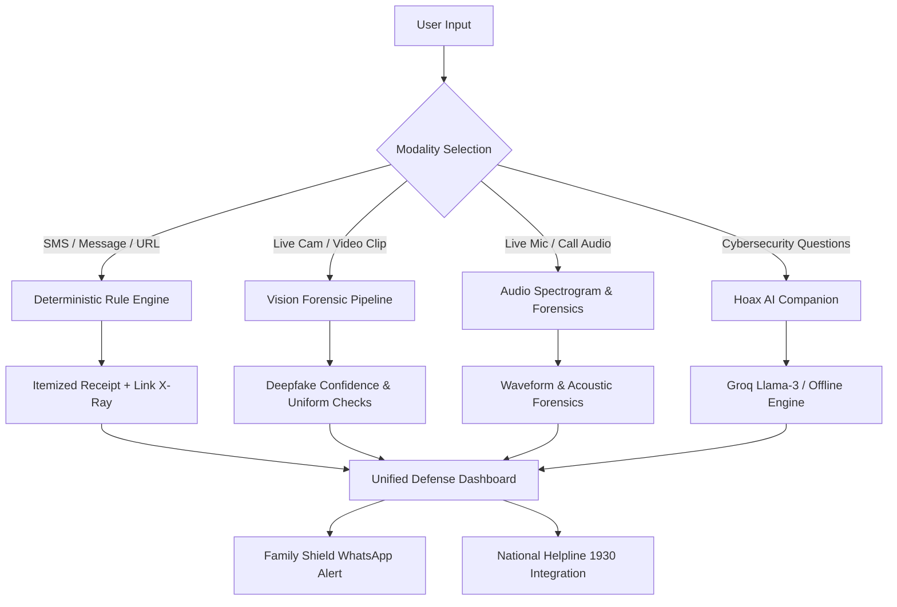

# Hoax 🛡️ — Autonomous Multi-Modal Fraud Defense Station

<div align="center">

[](https://react.dev/)
[](https://vitejs.dev/)
[](https://threejs.org/)
[](https://tailwindcss.com/)
[](https://vitest.dev/)
[](https://vercel.com/)
[](LICENSE)

<p align="center">
  <b>Next-generation multi-modal cyber defense platform engineered to detect and dismantle modern digital deception.</b><br/>
  Inspects phishing SMS messages, deepfake video calls, AI voice-cloning extortion audio, and deceptive lookalike URLs in real-time.
</p>

[**Explore Features**](#-key-features) • [**Live Demo & Deployment**](#-deployment-guide-vercel) • [**Quick Start**](#-quick-start) • [**Architecture**](#-system-architecture) • [**Rule Engine**](#-explainable-scoring-receipt)

</div>

---

## ⚡ Why Hoax?

Modern cyber fraudsters have evolved far beyond simple typo-ridden emails. Today's digital scams involve:
1. **Digital Arrest Scams:** Video calls featuring fraudsters wearing counterfeit police or CBI uniforms against fabricated police station backdrops.
2. **AI Voice Clones:** Cloned voices of loved ones or courier officers claiming seized narcotics packages.
3. **Deceptive Homograph Domains:** Lookalike domains like `sbi-kyc-update.com` that fool standard users.
4. **"Black Box" AI Tools:** Security tools that return vague percentages without explaining *why* a message is dangerous, causing panic or false alarms.

**Hoax solves this with a multi-modal, explainable, zero-knowledge approach.**

---

## ✨ Key Features

### 1. 📝 SMS & Text Phishing Scanner
* **Transparent Itemized Score Receipt:** Displays an open, grocery-style calculation where every point is traceable to audited deterministic rules (`+20 Urgency`, `+15 Threat`, `+25 Link`, `+40 OTP request`).
* **False-Alarm Negation Shield:** Distinguishes genuine transactional bank OTPs (*"Do not share this OTP with anyone"*) as **Good Signs (0 pts)**, preventing panic over legitimate communications.
* **Link X-Ray Deep Inspector:** Deconstructs suspicious URLs into protocol, subdomain, registered domain, and TLD. Performs an algorithmic character-by-character diff against genuine banking and enterprise domains.
* **Interactive What-If Tuner:** Live sensitivity drawer enabling users and security analysts to adjust rule weights and observe instant score recalculations.
* **Family Shield (1-Tap WhatsApp Warning):** Generates pre-formatted emergency warning messages in English or Hinglish with one-click direct `wa.me` links to alert vulnerable family members.

### 2. 🎥 Video & Deepfake Fraud Scanner
* **WebRTC Live Cam & File Upload:** Scan live webcam streams during incoming video calls or upload recorded MP4/WebM clips.
* **Forensic Vision Heuristics:**
  * **Ocular Blink Frequency:** Flags unnatural blinking rates (<4 blinks/min typical of early diffusion models).
  * **Phoneme-Lip Discrepancy:** Detects asynchronous audio-visual lip latency.
  * **Digital Arrest Uniform Detection:** Spots counterfeit police uniforms, fabricated emblems, and fake agency backgrounds.
* **In-Call Countermeasure Checklist:** Gives the user immediate actionable tests to expose deepfakes in real-time (e.g., asking the caller to turn 90° or wave their hand across their face).

### 3. 📞 Call Recording & Audio Fraud Scanner
* **Microphone Recording & Audio File Upload:** Inspect voice notes, recorded phone calls, and suspicious voicemails (MP3, WAV, M4A).
* **HTML5 Canvas Audio Visualizer:** Real-time waveform & frequency spectrogram rendering.
* **Acoustic Forensic Heuristics:**
  * **Voice Synthesis Detection:** Identifies flattened pitch dynamics and unnatural synthetic cadence.
  * **Boiler-Room Ambient Noise:** Detects telemarketing background hums and multi-chatter call center signatures.
  * **Extortion Script Matching:** Flags high-frequency scam triggers (*"customs duty"*, *"narcotics parcel"*, *"police FIR"*).
* **Forensic Timed Transcript:** Color-coded timeline highlighting critical risk triggers.

### 4. 🤖 Hoax AI Cybersecurity Assistant
* **Direct Floating Companion:** Accessible across all pages for contextual guidance, scam verification questions, and emergency response.
* **Clean End-User Experience:** End users ask queries directly without needing their own API keys or technical setup.
* **Developer Groq Backend Ready:** Supports instant integration with Groq's high-speed Llama 3 models via `VITE_GROQ_API_KEY` or `src/config/aiConfig.js`.
* **Zero-Setup Offline Fallback:** If no API key is configured, Hoax seamlessly operates using its built-in offline cyber intelligence engine.

### 5. 🌐 3D Interactive Cyber Threat Globe
* Built with **Three.js** and WebGL.
* Interactive holographic geodesic sphere featuring 280+ live threat nodes, rotating radar sweep rings, cyber defense orbital arcs, and smooth mouse-tracking inertia.

---

## 🏗️ System Architecture



---

## 🛠️ Tech Stack

| Category | Technology | Purpose |
| :--- | :--- | :--- |
| **Frontend** | React 19 (JSX) | Reactive UI components and state management |
| **Build Tool** | Vite 6.2 | Instant HMR and optimized production bundle |
| **3D Graphics** | Three.js (0.183) | Interactive holographic cyber threat globe |
| **Styling** | Tailwind CSS 3 | Modern dark-mode cyber aesthetic |
| **Motion** | Framer Motion & GSAP | Micro-interactions, slide drawers, and transitions |
| **Icons** | Lucide React | Cyber and security UI icon set |
| **Testing** | Vitest | Deterministic test runner for the rule engine |
| **Routing** | React Router v7 | Seamless SPA navigation |
| **Deployment** | Vercel | Global edge CDN deployment |

---

## 📁 Repository Structure

```
├── .env.example            # Environment variable template
├── .gitignore              # Git ignore rules (node_modules, dist, envs, logs)
├── LICENSE                 # MIT License
├── README.md               # Project documentation
├── vercel.json             # Vercel SPA route rewrite rules
├── vite.config.js          # Vite config & dev server settings
├── package.json            # Dependencies & build scripts
├── index.html              # HTML shell & Google Fonts (Plus Jakarta Sans, Inter)
│
├── public/                 # Static assets & favicon
│
└── src/
    ├── components/
    │   ├── 3d/             # Three.js 3D Threat Globe (HeroScene3D.jsx)
    │   ├── ai/             # Hoax AI Assistant Chatbot (HoaxChatbot.jsx)
    │   ├── audio/          # Call Recording & Audio Scanner (CallFraudScanner.jsx)
    │   ├── features/       # Link X-Ray, What-If Tuner, Family Shield, History Drawer
    │   ├── layout/         # Navbar, Footer & Quick Helplines
    │   ├── scanner/        # Text Scanner, Threat Gauge, Annotated Text, Score Receipt
    │   └── video/          # Deepfake Video Scanner (VideoFraudScanner.jsx)
    ├── config/             # Developer AI config (aiConfig.js)
    ├── context/            # Global AppContext (Theme, Scanner State, History)
    ├── engine/             # Audited Rule Engine & Vitest Test Suite (engine.test.js)
    ├── pages/              # Landing, Scanner App, How It Works, Pricing, Safety, About
    ├── styles/             # Custom design tokens & animations (theme.css)
    ├── App.jsx             # Root layout & route definitions
    └── main.jsx            # Application entry point
```

---

## ⚡ Quick Start

### Prerequisites
- Node.js (version 18 or higher)
- npm (version 9 or higher)

### 1. Clone the repository
```bash
git clone https://github.com/<your-username>/hoax.git
cd hoax
```

### 2. Install dependencies
```bash
npm install
```

### 3. Run the test suite
```bash
npm test
```
*Executes all 8 automated acceptance tests covering the deterministic heuristic engine, Link X-Ray parser, false-alarm bank OTP negation, and high-load stress testing.*

### 4. Start local development server
```bash
npm run dev
```
Open [http://localhost:5173](http://localhost:5173) in your browser.

---

## 🔑 Environment Configuration (Optional)

Hoax works immediately out of the box with zero configuration!

To power the **Hoax AI Cybersecurity Assistant** with high-speed Groq Llama 3 models:
1. Copy `.env.example` to `.env`:
   ```bash
   cp .env.example .env
   ```
2. Add your Groq API key:
   ```env
   VITE_GROQ_API_KEY=gsk_your_groq_api_key_here
   ```
*(You can also set it directly in `src/config/aiConfig.js`).*

---

## 🚀 Deployment Guide (Vercel)

Deploying Hoax on **Vercel** takes under 2 minutes:

### Option A: Via GitHub (Recommended)

1. **Push your repository to GitHub:**
   ```bash
   git add .
   git commit -m "feat: complete Hoax multi-modal fraud defense platform"
   git branch -M main
   git remote add origin https://github.com/<your-username>/<repo-name>.git
   git push -u origin main
   ```

2. **Import into Vercel:**
   - Go to [vercel.com/dashboard](https://vercel.com/dashboard) and log in.
   - Click **"Add New..."** → **"Project"**.
   - Select your GitHub repository and click **"Import"**.

3. **Configure Project Settings:**
   - **Framework Preset:** `Vite` (auto-detected)
   - **Root Directory:** `./`
   - **Build Command:** `npm run build`
   - **Output Directory:** `dist`
   - *(Optional)* Under **Environment Variables**, add `VITE_GROQ_API_KEY` if you wish to enable cloud AI assistance.

4. **Click "Deploy":**
   - Vercel builds the project and deploys it to a global edge CDN with an instant SSL certificate.

> [!TIP]
> **Why `vercel.json` is included:**
> Single-Page Applications (SPAs) with client-side routing need all subpath requests (`/app`, `/pricing`, `/safety`) to route through `index.html`. The repository includes [`vercel.json`](vercel.json) pre-configured with rewrites so your routes never return 404 on refresh!

---

### Option B: Via Vercel CLI

```bash
# 1. Install Vercel CLI
npm install -g vercel

# 2. Login to Vercel
vercel login

# 3. Deploy
vercel

# 4. Deploy to production
vercel --prod
```

---

## 🔒 Security & Privacy Notice

* **On-Device Sandbox:** Text analysis and heuristic parsing occur entirely inside the user's browser sandbox.
* **No PII Storage:** No personal identifiable information (PII), bank details, or scanned text messages are transmitted to any external surveillance databases.
* **Emergency Assistance:** If you or someone you know has been targeted by financial fraud, immediately call the National Cybercrime Reporting Helpline at **1930** or report online at [cybercrime.gov.in](https://cybercrime.gov.in).

---

## 📄 License

This project is open-source and distributed under the [MIT License](LICENSE).
